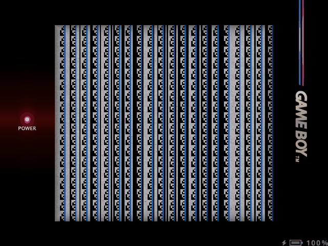
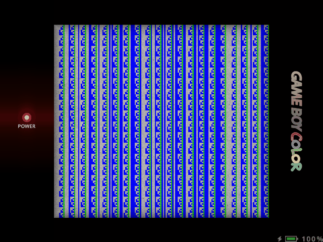
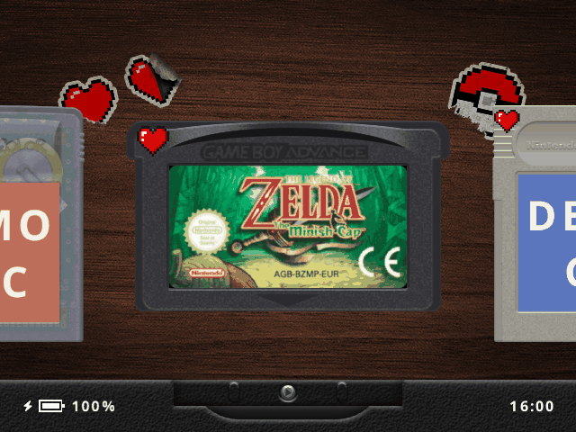
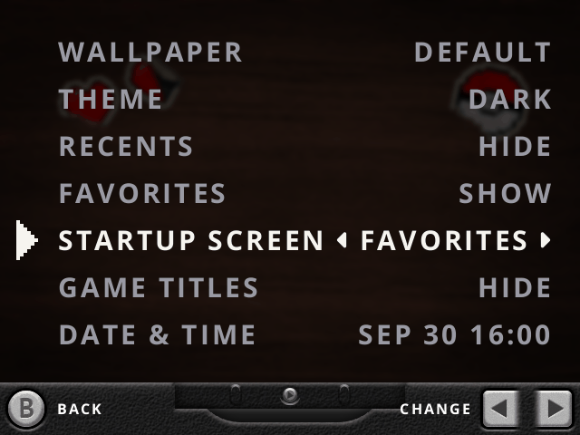
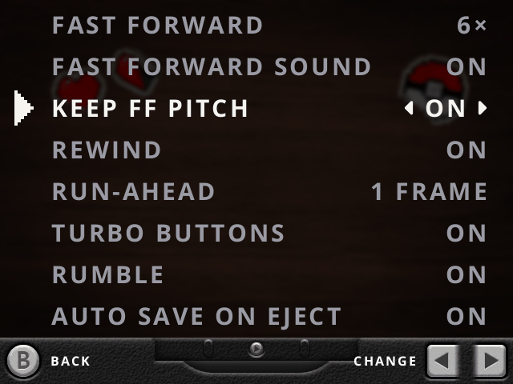

---

# About this fork

An **unofficial fork** of [slot](https://github.com/BrandonKowalski/slot) by Brandon Kowalski. Not affiliated with or endorsed by him: please report this fork's problems here. Same license, GPL-3.0-or-later.

Some features are adapted from other slot forks and pull requests: [slot.advance](https://github.com/suprsomething/slot.advance)
by suprsomething (battery warnings, standby, favorite heart), [snowslots](https://github.com/chiyuki0325/snowslots) by
chiyuki0325 (fast-forward pitch), [jgraving/slot](https://github.com/jgraving/slot) by jgraving (link play from the Favorites and Recents shelves),
[stevolarn/slot](https://github.com/stevolarn/slot) (faster scrolling), and the Classic bezels are mugwomp93's from
[knulli-bezels](https://github.com/chrizzo-hb/knulli-bezels) by chrizzo-hb. Thank you!

**Tuned and tested on the Anbernic RG35XXSP**: bezels that fill its 640x480 screen, and every feature checked on the
device. The other handhelds slot supports should work as before, but this
fork is not tested on them.

[User guide](https://slot-cfw.fyi) · [Changelog](CHANGELOG.md) · [Wiki](https://github.com/marghost/slot_modded/wiki)

# Documentation - [The Wiki](https://github.com/marghost/slot_modded/wiki)

Everything technical lives in the wiki, one page per topic all the documentation you need:

| Page | What it contains |
|---|---|
| [Settings and Controls](https://github.com/marghost/slot_modded/wiki/Settings-and-Controls) | Every button and settings row the fork adds, with values and defaults |
| [SD Card Files](https://github.com/marghost/slot_modded/wiki/SD-Card-Files) | Files you can add to the card (favorites, recents, boot logo, sticker, bezels) and the `slot.state` keys |
| [RG35XXSP](https://github.com/marghost/slot_modded/wiki/RG35XXSP) | How the 640×480 screen is laid out, with pixel positions, and what is tuned for it |
| [Troubleshooting](https://github.com/marghost/slot_modded/wiki/Troubleshooting) | Where the logs are, common surprises, going back to the original slot |
| [Building](https://github.com/marghost/slot_modded/wiki/Building) | Run on a PC, build for the console, run the tests |

# What's new on this Fork

| Feature | How to get there |
|---|---|
| **Battery %** in game | Always on, any game and any console, bottom-right of the bezel (4:3 screens like the RG35XXSP are compatible). Green → red as it drains. |
| **Classic GB / GBC bezels** | Settings: MENU → Screen → Game Boy / Game Boy Color → **Bezel** → Classic (default on 4:3 screens). Full-screen 640x480, no black bars; other bezels fill the bars too. Art by mugwomp93 |
| **Button Cheat Sheet** | Settings: MENU → **Button Cheat Sheet**.  This will tell you all the hotkeys! |
| **Button Cheat Sheet** in game | In-game menu: tap MENU → **Button Cheat Sheet**, or in the save state switcher (double-tap MENU) → **START** (Button Help) |
| **Favorite heart** | A pixel heart marks your favorite games on the cartridge, and a banner confirms when **Y** adds or removes one. Your own icon: put your PNG at `System/favorite.png` |
| **Show / hide Favorites** | Settings: MENU → General → **Favorites**. Your hearts are kept while the shelf is hidden |
| **Startup Screen** | Settings: MENU → General → **Startup Screen** (Last Used, Recents, Favorites, GBA, GB or GBC).  Choose folder/shelf at boot. |
| **Shelf memory** | Automatic: each shelf opens on the game you left it on, also after a restart |
| **Keep FF Pitch** | Settings: MENU → Gameplay → **Keep FF Pitch** (also in game: MENU → Settings → Gameplay), with Fast Forward Sound on.  This lower the pitch of the game music when you FF.  |
| **Low-battery warning** | Automatic alerts, at 15% and 10% |
| **Standby** | Automatic: with the lid shut, slot stops drawing screen image to save battery |
| **Fullscreen menus** | Automatic on 4:3 screens like the RG35XXSP: Settings, About, Date & Time and the Button Cheat Sheet fill the whole screen, no black strip at the bottom |
| **Faster scrolling** | Hold Left or Right for 2 s on a shelf of 60+ games: it moves 3 carts a step |

# Try this fork on your device

Both options use the [latest release](https://github.com/marghost/slot_modded/releases/latest). slot's SD card is the
card in SD1 (also labelled TF1) if you use one card, or the card in SD2 if you use two.

## Quick: replace the slot file

For a handheld that already runs slot OS. Your games, saves and states stay as they are.

1. Download [`slot`](https://github.com/marghost/slot_modded/releases/latest/download/slot).
2. Turn the handheld off and put slot's SD card in your computer.
3. In the card's `System` folder, rename the original `slot` file to `slot.orig`. That keeps it as a backup.
4. Copy the downloaded `slot` into the card's `System` folder.
5. Optional, if you use the gpSP emulator: also download
   [`gpsp_libretro.so`](https://github.com/marghost/slot_modded/releases/latest/download/gpsp_libretro.so) and copy it
   over `System/gpsp_libretro.so`, for the original author's latest gpSP fix.
6. Eject the card safely, put it back in the handheld and turn it on.

To go back to the original slot, delete `System/slot` and rename `System/slot.orig` back to `slot`.

## Fresh install

For a handheld without slot, or to start over. slot runs on top of
[Base OS](https://github.com/pvaibhav/BaseOS), so Base OS has to be installed first. The original author's
[installation guide](https://slot-cfw.fyi/#install) walks through every step, with single and dual SD card setups; in
short:

1. Flash the [latest Base OS release](https://github.com/pvaibhav/BaseOS/releases/latest) to an SD card, for example
   with Raspberry Pi Imager, and insert it in SD1.
2. Turn the handheld on once so Base OS expands its storage, then turn it off when it says no frontend was found.
3. Download `slot-<version>-h700.zip` from the [latest release](https://github.com/marghost/slot_modded/releases/latest)
   and unzip it.
4. Copy everything inside the unzipped `slot-<version>/` folder onto the root of the Base OS card (one card), or onto a
   second card formatted FAT32 or exFAT with an MBR partition table, for SD2 (two cards).
5. Add your games, unzipped, to `Games/GBA`, `Games/GB` or `Games/GBC`, and optionally `gba_bios.bin` to `BIOS/`.
6. Put the card back in the handheld and turn it on.

# Screenshots

 
<em>The Classic Game Boy bezel, made for the RG35XXSP's 640x480 screen, with the battery badge.</em>

 
<em>The Classic Game Boy Color bezel.</em>

 
<em>The Favorites shelf, with a heart on each favorite.</em>

 
<em>The settings menu, with the Button Cheat Sheet.</em>

 
<em>Button Cheat Sheet</em>

 
<em>Startup Screen and Show / hide Favorites, on the General page.</em>

 
<em>Keep FF Pitch, on the Gameplay page.</em>

 
<em>START Button Help in the save state switcher, and the battery badge on the GBA SP frame.</em>

---

# Fork AI Disclosure

- **Written by AI.** Every change in this fork, both the Rust code and the documentation in the [CHANGELOG](CHANGELOG.md), was written by Claude Opus.
  The original project has its own
  [AI Disclosure](https://github.com/BrandonKowalski/slot#ai-disclosure). Its
  code was also put together by Claude Opus.
- **Not reviewed by the original author.** Brandon Kowalski has not reviewed, tested or approved anything in this
  fork. Any bug here may be the fork's own, so check whether it also happens on the original slot before reporting it
  there.
- **No warranty.** As the GPL-3.0-or-later license says, this software comes with no warranty. AI-written code can
  contain mistakes that tests do not catch. Use it at your own risk, and keep a backup of your saves and SD card.

---

# Support the original author

If you enjoy slot, consider supporting its original author, Brandon Kowalski, on
[Ko-fi](https://ko-fi.com/kwallbmoc). This fork does not take donations.
