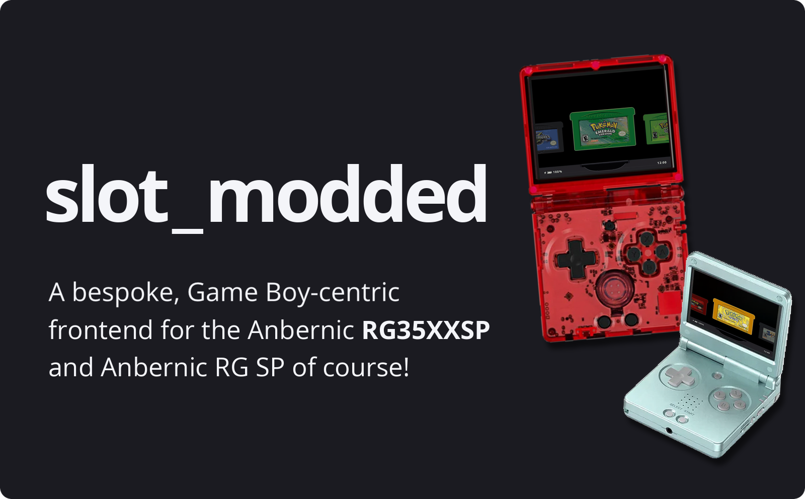
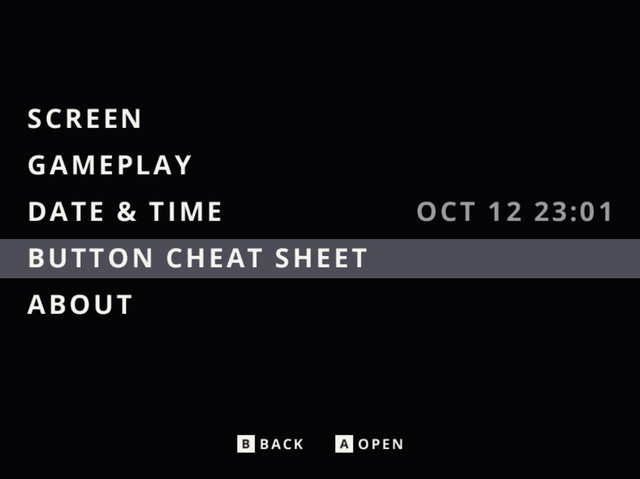
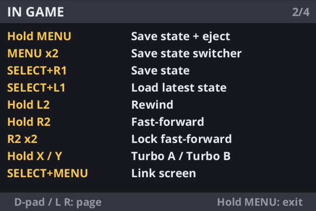
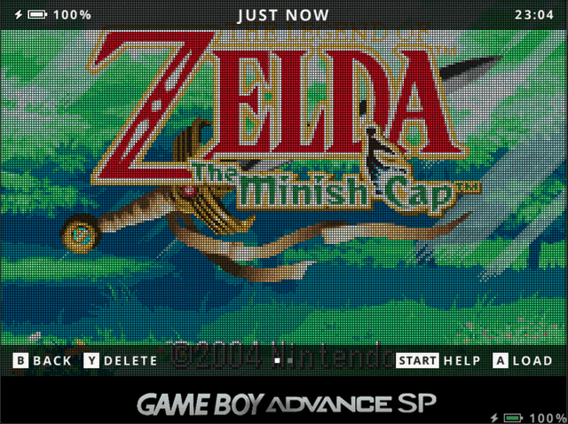

---

# About this fork

This is an **unofficial fork** of [slot](https://github.com/BrandonKowalski/slot) by Brandon Kowalski, maintained by
marghost. All credit for the original project goes to Brandon Kowalski. This fork is not affiliated with or endorsed by
him, so please do not report problems with this fork to the original project.

It stays under the same license, GPL-3.0-or-later (see [LICENSE](LICENSE)).

- User guide (for the original slot, which this fork follows): [slot-cfw.fyi](https://slot-cfw.fyi)
- Release notes, including this fork's changes: [CHANGELOG](CHANGELOG.md)

# Changes from the original

- The battery level (gauge + "NN%", a bolt while charging) stays on screen in game, in the bottom-right corner over
  the GBA SP bezel, on 4:3 screens such as the RG35XXSP. It is half transparent, and the gauge fill goes from green to
  yellow to orange to red as the battery drains.
- A **Button Cheat Sheet** entry in the settings menu, between Date & Time and About, lists every button shortcut on
  four pages: carousel, in game, screen & sound, and the save state switcher. D-pad Left/Right or L1/R1 turn the
  pages; B or MENU goes back to the menu. START in the save state switcher (shown as "START Help" in its bottom
  bar) opens it on its In Game page; B goes back to the switcher.

# Screenshots

The settings menu and a cheat sheet page, then the save state switcher with its START Help hint and the battery
badge in the bezel's bottom-right corner. Captured from the desktop build in a 4:3 window, as on the RG35XXSP.

---

# Fork AI Disclosure

- **Written by AI.** Every change in this fork, both the Rust code and the documentation (this README and the fork
  entry in the [CHANGELOG](CHANGELOG.md)), was written by Claude Opus, Anthropic's AI model, working in Claude Code.
  The original project has its own
  [AI Disclosure](https://github.com/BrandonKowalski/slot#ai-disclosure), which covers only the original project. Its
  code was also put together by Claude Opus, but its documentation is human-written; this fork's documentation is not.
- **Not reviewed by the original author.** Brandon Kowalski has not reviewed, tested or approved anything in this
  fork. Any bug here may be the fork's own, so check whether it also happens on the original slot before reporting it
  there.
- **No warranty.** As the GPL-3.0-or-later license says, this software comes with no warranty. AI-written code can
  contain mistakes that tests do not catch. Use it at your own risk, and keep a backup of your saves and SD card.

---

# Support the original author

If you enjoy slot, consider supporting its original author, Brandon Kowalski, on
[Ko-fi](https://ko-fi.com/kwallbmoc). This fork does not take donations.
